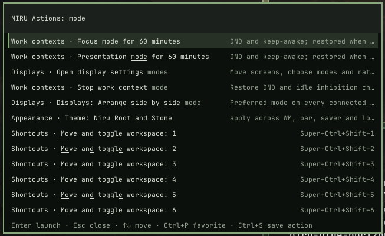

# NIRU Launcher

Keyboard-first launcher for applications, windows, web search, settings and NIRU Actions on the NIRUX desktop.

**Status: beta** · Part of the [NIRUX](https://github.com/nirucon/nirux) suite · [MIT License](LICENSE)



## About

NIRU Launcher (`nirulauncher`) is the one keyboard entry point to NIRUX. It
starts applications, switches windows, searches the web, opens Quick Settings
and runs NIRU Actions: practical system actions such as display profiles,
power, Wi-Fi, Bluetooth, sound, themes and diagnostics.

It is one process per invocation: no daemon, no indexing service and no network
access of its own. Settings views are thin front ends over the same `niructl`,
`nirux` and system providers the rest of the suite uses, so there is never a
second, competing settings implementation.

## Features

- Application search with multi-word, keyword, diacritic-insensitive and
  conservative fuzzy matching, favourites, pins and launch-history ranking.
- Window switcher and workspace-grouped overview.
- Dedicated web search with seventeen built-in engines, aliases (`gh niruwm`)
  and your own engines in a few lines of TOML.
- NIRU Actions: a grouped catalogue of system, display, power, appearance,
  wallpaper, Wi-Fi, workspace and window actions, plus saved actions.
- Deterministic intent phrases ("lock", "focus mode", "volume up") in English,
  Swedish and more, without any model or network.
- Settings views: Wi-Fi, wired Ethernet, Bluetooth, sound and event sounds,
  microphone, displays, power, themes, timing, input, key bindings and Health.
- Keybinding cheat sheet (`Super+/`): every key in effect with words, search
  by words or keys, Enter runs a binding, Ctrl+R tells what a key does,
  clashes are marked.
- Emoji and symbol picker (`Super+.`, or `:name` in the unified view): color
  emoji, ©, ®, ™, arrows, °, ±, currency and typographic quotes, English and
  Swedish names, recents first, skin tones, pasted where you were typing.
- Colors view: the last colors picked with `nirushot pick` (`Super+Ctrl+C`).
- Manual view (`--manual`, *Manual* in NIRU Actions, or the phrases `manual`,
  `help`, `hjälp`): the chapters and headings of the installed NIRUX manual,
  searchable by heading and by the text under it; Enter opens the chapter at
  that heading with `nirux manual`.
- File search (`--files`, *Find files* in NIRU Actions, or `/ name` in the
  unified view): your home folder through `plocate`, `fd` or a bounded
  built-in walk, recently used files first, without hidden folders, caches
  and build output. Enter opens, Ctrl+Enter opens the folder, Shift+Enter
  copies the path.
- Quick Settings and NIRU Actions show the current state of NIRUWM's studio
  mode and window swallowing and toggle them (`niructl studio toggle`,
  `niructl swallow toggle`); intent phrases `studio mode` / `studioläge`.
- Calculator row (`2+2*3`, `15% of 240`), copied with Enter.
- Optional OpenCode handoff through `niructl agent`, never auto-approved.
- HiDPI scaling from `Xft.dpi`, dead-key composition and AltGr levels.

## Requirements

- Debian, Arch or Void Linux (glibc), x86_64, with X11.
- A monospaced font through fontconfig, or `font_path`.
- Optional: Noto Color Emoji for color emoji (without it the picker shows
  names and the text symbols), `niructl` (NIRUWM) for actions and settings, NetworkManager or
  `wpa_supplicant` for Wi-Fi, `xclip` for the calculator, `opencode` for the
  agent handoff.
- Building from source: Rust and `cargo`.

## Installation

### With NIRUX

NIRU Launcher is a core component. `nirux install` installs it with the rest of
the suite and `nirux update` keeps it current. See the
[NIRUX README](https://github.com/nirucon/nirux#installation).

### Standalone

```sh
git clone https://github.com/nirucon/nirulauncher
cd nirulauncher
./install.sh            # download the released binary and verify its checksum
./install.sh --build    # or build from this checkout (needs cargo)
```

The binary goes to `~/.local/bin` (override with `NIRULAUNCHER_PREFIX`) and the
example configuration to `~/.config/nirulauncher/` when none exists. The
installer refuses to replace a NIRUX-managed copy; use `nirux update` there.

## Usage

Default NIRUWM keys:

| Keys | View |
|---|---|
| `Super+P` | Applications |
| `Super+Shift+P` (also `Super+Shift+B`, `Super+Shift+M`) | Applications, windows, actions and settings in one view |
| `Super+A` | NIRU Actions |
| `Super+S` | Web search |
| `Super+V` | Clipboard history |
| `Super+O` | File search |
| `Super+/` or `Super+F1` | Keybinding cheat sheet |
| `Super+Shift+F1` | The NIRUX manual |
| `Super+.` | Emoji and symbols |
| `Alt+Tab`, `Super+W`, `Super+grave` | Window switcher |

On Swedish, German and similar layouts `/` is `Shift+7`, so use `Super+F1` for
the cheat sheet there. `nirux manual launcher` describes every view.

Inside the launcher: ↑/↓ and Tab move, PageUp/PageDown page, Home/End jump,
Enter opens, Escape closes, Ctrl+Backspace deletes a word, Ctrl+P pins or
unpins a row and Ctrl+S saves an app or command row as a NIRU Action.

Each view can be opened directly:

| Option | View |
|---|---|
| `--apps` | Application search (default) |
| `--actions` / `--system-actions` | Grouped NIRU Actions / the focused actions view |
| `--windows` (alias `--overview`) | Window switcher |
| `--search [PHRASE]` | Web search, optionally with the phrase filled in |
| `--quick` | Quick Settings |
| `--clipboard` | Clipboard history |
| `--keys` | Keybinding cheat sheet |
| `--emoji` | Emoji and symbol picker |
| `--colors` | The last picked colors, and Pick color |
| `--manual` | The NIRUX manual: chapters and headings, searchable |
| `--files` | File search in the home folder, recent files first |
| `--settings` | NIRUX Settings: appearance, wallpaper, displays, audio, keys, timing |
| `--themes`, `--displays`, `--power`, `--timing`, `--input` | Single settings views |
| `--wifi`, `--wired`, `--bluetooth`, `--tailscale` | Network and devices |
| `--sound`, `--microphone` | Outputs, inputs, streams, event sounds, microphone test |
| `--clip` | NIRUCLIP capture profiles, overlays, camera check and preview, MP4/GIF export and sharing, recovery and status |
| `--share`, `--share-pair` | NIRUSHARE devices, inbox, pairing and Discord webhooks |
| `--health` | Installed/running, session, audio, network, display and capture status |
| `--agent` | Short OpenCode prompt, then a centred terminal |

Non-interactive helpers: `--list`, `--list-actions`, `--list-search`,
`--wifi-status`, `--wifi-scan`, `--wired-status`, `--list-files QUERY`,
`--check-config` and `--version`.

**Share and Discord.** With NIRUSHARE 0.4.0 or newer, the Share view lists
every Discord webhook configured in `~/.config/nirushare/webhooks.toml` as
*Share clipboard to Discord · NAME* (or *Share image …* when NIRUSHOT's review
opened the view with a screenshot). Choosing one never sends anything: it
opens a preview view that shows the target, the content, its size, how many
messages it becomes and the start of the text. **Send to Discord · NAME**
posts exactly what the preview showed; **Cancel** goes back to Share. The
"Sent to Discord" notification has **Undo** for 5 minutes. The launcher only
ever sees webhook names, never their URLs. With an older NIRUSHARE the
Discord rows simply do not appear.

**Keybinding cheat sheet (`Super+/`).** Every key in effect, from
`niructl keys --json` (NIRUWM 0.18 or newer): NIRUWM's bindings, including
your own `[[keys]]` with their optional `description`, and the keys other
programs register in `~/.local/share/niru/keys.d` (see NIRUWM's
KEYBINDINGS.md). The list is grouped; type words (`scratchpad`) or a key
(`super+t`, `ctrl alt space`) to search. **Enter** runs the selected binding
as if the key were pressed (`niructl keys run`), or the command a registered
program gave for its key. **Ctrl+R**, then a key combination, shows what it
does or that it is free. A key two programs claim is marked *conflict*; the
footer names the other one. With an older NIRUWM the view shows the plain list
as before.

**Emoji and symbols (`Super+.`).** About 1 900 emoji (Unicode 16.0) and 85
text symbols (©, ®, ™, arrows, °, ±, ×, currency signs, typographic quotes,
dashes, no-break space), with English and Swedish names and keywords from
Unicode CLDR, compiled into the program. Recently used ones come first.

- **Enter** pastes into the window you were typing in, then gives the
  clipboard back as it was (every format it held, images too). Terminals get
  Ctrl+Shift+V, xterm-like terminals Shift+Insert. If nothing takes the paste,
  the emoji stays on the clipboard.
- **Shift+Enter** only copies.
- **Tab** / **Shift+Tab** cycle the skin tone of the emoji that have one; the
  choice is remembered.
- In the unified view (`Super+Shift+P`), `:heart` shows the best eight matches.

Color emoji are drawn from Noto Color Emoji's bitmaps, scaled once per row
size; the font is only read when the first emoji row is shown.

**Colors.** `--colors` (or *Colors* in NIRU Actions) lists the last ten colors
NIRUSHOT picked, newest first, with a swatch; Enter copies the hex value.
*Pick color* runs `nirushot pick` (also `Super+Ctrl+C`).

**Manual.** `Super+Shift+F1`, `--manual`, *Manual* in NIRU Actions, or the phrase `manual`,
`help` or `hjälp` lists the chapters and their headings of the NIRUX manual
installed with the release (the directory `nirux manual --path` prints).
Typing searches the headings and the text under them. Enter runs
`nirux manual CHAPTER#ANCHOR`, which opens the chapter at that heading
(NIRUNOTE when installed). Without an installed manual the view says so and
points to `nirux update`.

**File search.** `Super+O`, `--files`, *Find files* in NIRU Actions, or `/`
followed by a name in the unified view (`Super+Shift+P`, also `Super+P` and
`Super+A`): `/ faktura` or `/faktura 2024`.

- An empty field (or a lone `/`) lists recently used files
  (`~/.local/share/recently-used.xbel`), newest first, marked ↺. While
  typing, recent files that match come first, then the best matches.
- Words match in any order, in the file name or its folders, ignoring case
  and diacritics (`faktura aao` finds `faktura-åäö.pdf`); a word in the file
  name ranks above one in a folder name. Rows show the kind (PDF, Image,
  Folder, …), the name and the folder (`~/Fakturor`).
- **Enter** opens with `xdg-open`, **Ctrl+Enter** opens the containing
  folder, **Shift+Enter** or **Ctrl+C** copies the path.
- Searched: the home folder, without hidden files and folders, and without
  `.cache`, the trash, `.git`, `node_modules`, `target`, `__pycache__`,
  `.venv` and similar (see `[files]` below).
- Backends, in the order `auto` tries them: `plocate` (or mlocate's
  `locate`) when its database covers the home folder, `fd`/`fdfind`, then a
  built-in walk that lists the home folder once per open (at most 250 000
  entries or 8 seconds) and searches that list in memory. Every search runs in
  the background and is cancelled by the next key; it stops after 1.5 seconds
  and shows what it found. The footer names the backend and the time. A
  `locate` database only knows files from its last `updatedb` run.

The complete behaviour of every view (actions catalogue, intent phrases,
Wi-Fi, wired networking, web search, sound and settings) is described in
[docs/GUIDE.md](docs/GUIDE.md).

## Configuration

Launcher settings live in `~/.config/nirulauncher/config.toml`; start from
[config.example.toml](config.example.toml). Colours and font come from the
NIRUWM theme in `~/.config/niruwm/config.toml`.

```toml
width = 640
max_rows = 12
row_height = 26
padding = 12
font_size = 15.0
terminal = ["kitty"]          # for Terminal=true applications
# browser = ["brave"]         # else NIRUWM's browser, $BROWSER, xdg-open
favorites = ["firefox", "kitty"]
rank_by_usage = true

[search]
default = "duckduckgo"
order = ["duckduckgo", "github", "archwiki", "wikipedia"]

[[search.sources]]
id = "searx"
label = "SearXNG (home)"
url = "https://searx.example/search?q={query}"
alias = "sx"

[files]                       # file search; every key is optional
enabled = true
roots = ["~"]
backend = "auto"              # auto, plocate, locate, fd, builtin
max_results = 50
show_hidden = false
# locate_db = "~/.cache/files.db"  # plocate/locate -d: a database you built
# exclude = [".cache", ".local/share/Trash", ".git", "node_modules", "target"]
```

`{query}` is replaced by the percent-encoded phrase; only `http` and `https`
addresses are opened. `enabled = false` on a built-in id turns that engine off.
`exclude` replaces the built-in list of skipped names (a name such as
`node_modules` or `*.o`, or a path below a root such as `.local/share/Trash`);
the built-in list is in [config.example.toml](config.example.toml).
Set `NIRU_UI_SCALE` (0.75 to 2.5) to override HiDPI detection, or `1` to disable
it. Check a file with `nirulauncher --check-config`.

## Files and paths

| Path | Purpose |
|---|---|
| `~/.config/nirulauncher/config.toml` | Launcher settings |
| `~/.local/state/nirulauncher/usage.tsv` | Launch history (last 500 launches) |
| `~/.local/state/nirulauncher/emoji-recent.txt`, `emoji-tone` | Recent emoji and the chosen skin tone |
| `~/.local/state/nirushot/colors.json` | Picked colors (written by NIRUSHOT, read here) |
| `~/.local/share/recently-used.xbel` | Recently used files (written by GTK and other programs, read here) |
| `~/.config/niruwm/config.toml` | Theme, font and browser fallback |
| `~/.local/bin/nirulauncher` | Program |

## Troubleshooting

- **A settings view says "unavailable".** The provider is missing or too old
  (for example `niructl`, `nmcli` or an older NIRUX); the launcher never
  pretends an action succeeded.
- **Wi-Fi cannot connect through iwd or ConnMan.** They are detected but not
  controlled; use NetworkManager or `wpa_supplicant`.
- **Text is tiny or huge.** Set `NIRU_UI_SCALE`.
- **Emoji are names without pictures.** Install Noto Color Emoji
  (`fonts-noto-color-emoji`, `noto-fonts-emoji`); `NIRU_EMOJI_FONT=/path` points
  at another CBDT font.
- **An emoji was not pasted.** Some programs ignore synthetic keys; the emoji
  is then left on the clipboard for Ctrl+V. A clipboard history may record the
  emoji for a moment while it is pasted.
- **File search misses a new file.** With `plocate`/`locate` the database is
  updated by `updatedb` (usually daily); set `backend = "fd"` in `[files]` to
  search the disk directly.
- **plocate is installed but not used.** It is only used when its database
  knows the roots. Without root you can build your own and point at it:
  `updatedb.plocate -o ~/.cache/files.db -U ~ -l no`, then
  `locate_db = "~/.cache/files.db"` in `[files]`.
- **A web search engine opens the wrong browser.** Set `browser` in the
  launcher config.

## Uninstall

With NIRUX, use `nirux uninstall`. A standalone install is removed with:

```sh
./install.sh --uninstall
```

Configuration in `~/.config/nirulauncher` is kept.

## Building from source

```sh
cargo build --release --locked
cargo fmt --check
cargo clippy --all-targets -- -D warnings
cargo test -- --test-threads=1
sh tests/ui-smoke.sh target/release/nirulauncher
sh tests/theme-colors.sh target/release/nirulauncher
sh tests/first-paint.sh target/release/nirulauncher   # 150 ms first paint, memoized providers
sh tests/event-sounds.sh target/release/nirulauncher  # Sound view through a fake nirux
sh tests/files.sh target/release/nirulauncher         # file search, every backend
```

## Status, disclaimer and how it's made

**Status: beta.** I use the launcher dozens of times a day; the application,
window and search views are solid, while some settings views depend on
providers that are not available everywhere.

NIRUX and every niru* project are made by me, Nicklas Rudolfsson
([@nirucon](https://github.com/nirucon)), for me. They are tailored to my own
needs, preferences and workflows, on my own machines. If they fit yours too,
that's a nice bonus.

- **Free and open source.** Anyone is free to use, study, change and share
  it under the [MIT License](LICENSE).
- **No guarantees.** There is no warranty of any kind. Use it at your own
  risk, read what you install and keep backups of anything that matters.
- **How it's made.** Some of these projects I built from scratch by hand. In
  more recent releases I have used Claude, Anthropic's AI, to do much of the
  heavy lifting under my direction: I decide what to build and how it should
  behave, and I test it on my own machines. It saves me a lot of time, and
  the result is quite OK.
- **Alpha, beta, dev, and maybe forever.** Most things here are alpha, beta
  or dev, and may stay that way. Maybe one day there will be a real stable
  release, but given how fast development moves, and how I am as a person,
  maybe never :)

| Label | Meaning |
|---|---|
| dev | Under active construction; may not build, install or work yet. |
| alpha | Works on my machines, but incomplete or rough; expect breaking changes. |
| beta | In daily use on my machines and mostly complete; rough edges remain. |

## License

MIT License, see [LICENSE](LICENSE). Copyright (c) 2026 Nicklas Rudolfsson.

The emoji names and keywords in `data/emoji.tsv` come from Unicode
emoji-test.txt 16.0 and CLDR 46 annotations, © Unicode, Inc., under the
Unicode License v3 ([data/LICENSE-UNICODE.txt](data/LICENSE-UNICODE.txt));
`tools/gen-emoji.py` rebuilds the file.
